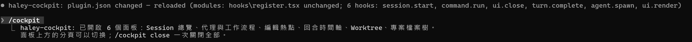
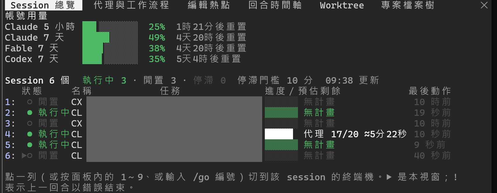
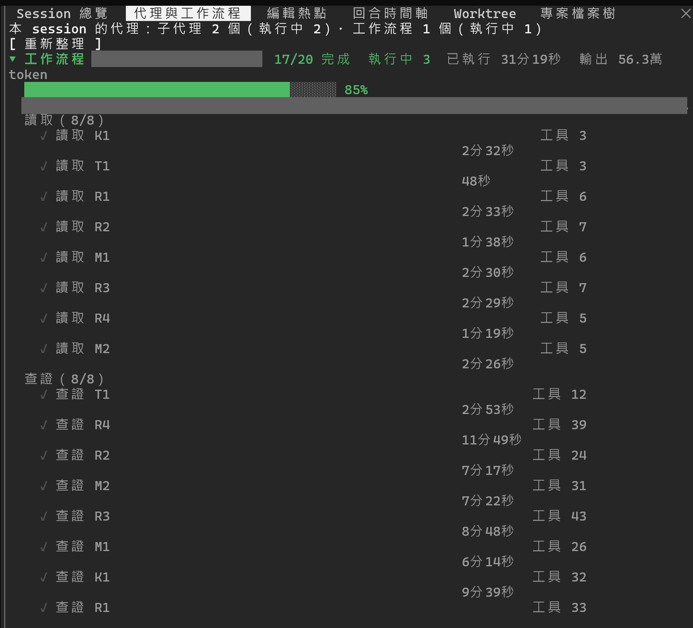
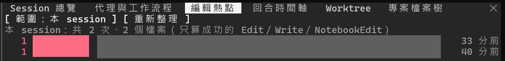
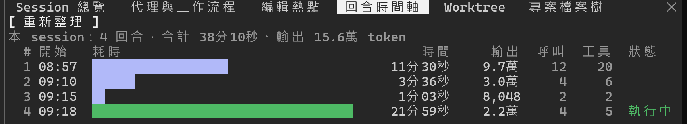
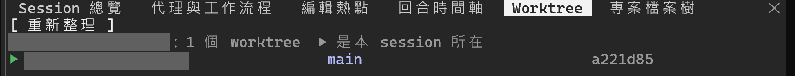
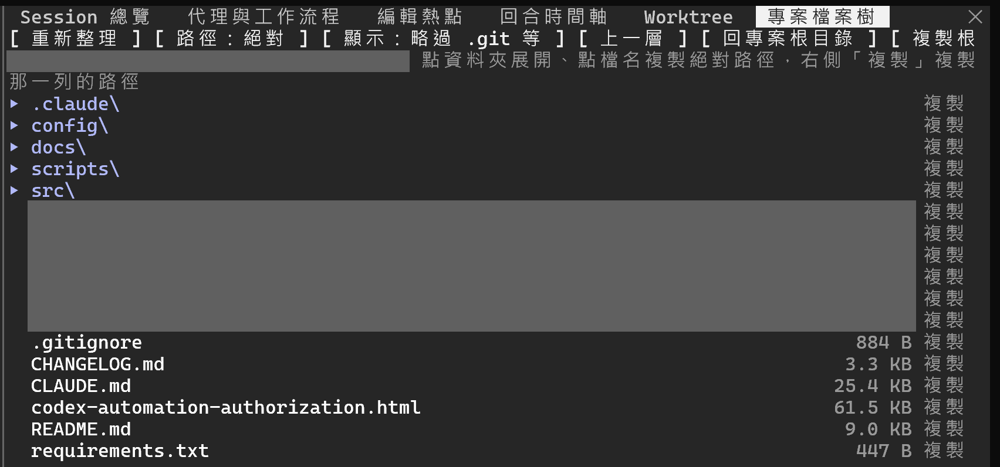

# Haley Claude Mods

自製的 Claude Code mods 與配套工具（非官方）。目前收錄：

| 資料夾 | 是什麼 |
|---|---|
| [`haley-cockpit/`](haley-cockpit/) | Claude Code mod「駕駛艙」：本機所有 Claude／Codex session 的總覽與帳號用量（含 Fable 額度）、可快速切換的 session 清單（VS Code 或 Windows Terminal）、子代理與工作流程、編輯熱點、回合時間軸、git worktree、專案檔案樹；一個指令開啟全部面板；另附一支狀態列程式 |
| [`vscode-session-switch/`](vscode-session-switch/) | 配套的 VS Code 擴充：狀態列右側顯示用量；右側欄「Claude 駕駛艙」每個 session 一條進度條，名稱和終端機分頁相同，點一下切到該終端機（VS Code 或 Windows Terminal） |

> ⚠️ **使用前請先讀完下方〈免責聲明〉。** 這是個人工具，不是官方產品。

## 免責聲明

1. **非官方**：本專案是個人自製的工具，與 Anthropic、OpenAI、Microsoft 沒有任何關係，也未經它們審核、認可或背書。Claude、Claude Code、Codex、ChatGPT、Visual Studio Code 等名稱與商標屬於各自的所有者。
2. **API 可能變動**：Claude Code 的 mod（函式掛鉤外掛）API 目前是搶先體驗（early access），官方註明各版本之間可能變動而不另行通知。本專案只在這個環境測試過：Windows 11、Claude Code 2.1.301／2.1.302、Codex CLI 0.163、VS Code 1.138、Python 3.13。其他版本或平台可能部分或完全無法運作。
3. **依現狀提供，不負擔保責任**：本專案依「現狀」提供，不附任何明示或默示的保證，包括但不限於適售性、特定用途適用性與不侵權。因使用或無法使用本專案而產生的任何直接或間接損失，例如資料遺失、帳號用量或費用消耗、工作中斷、設定檔損壞，作者概不負責；使用風險由使用者自行承擔。[MIT 授權條款](LICENSE)中的免責條款同樣適用，以英文原文為準。
4. **會讀取你的 session 紀錄**：為了顯示進度，本工具會在你的電腦上讀取 Claude Code 與 Codex 的 session 紀錄檔（`~/.claude/projects/`、`~/.codex/sessions/` 等），這些檔案可能含有你的程式碼、提示與 AI 回覆。所有解析都在本機進行：本工具自己不連網、不上傳，也不修改那些紀錄檔（唯一的間接例外：為了顯示 Fable 這類模型專屬額度，背景每 5 分鐘會執行一次官方的 `claude -p /usage` 指令，連網的是官方程式，本工具只解析它印出的文字，不碰你的登入憑證）。面板會在畫面上顯示 session 標題與待辦項目的文字，檔案樹會顯示你的資料夾與檔名，在共用螢幕、錄影或受管理的電腦上使用前，請自行評估風險。完整清單見〈會讀寫哪些檔案〉。
5. **會操作你的視窗**：點選切換到 Windows Terminal 裡的 session 時，本工具會用 Windows 的 UI Automation 讀取 Windows Terminal 視窗的分頁名稱、選取對應的分頁並把視窗帶到前景。只在你主動點選或輸入 `/go` 時才會執行；找不到唯一對應的分頁時不會亂選。
6. **數字是推算的**：用量百分比、重置倒數、預估剩餘時間與停滯判斷，都是依本機紀錄，以及各 session 最近一次收到的回應推算，可能落後，也可能與官方顯示不同。請以官方介面（例如 Claude Code 的 `/usage`）為準，不要依這些數字做計費或排程決策。
7. **不保證維護**：本專案可能隨時停止更新，也可能不經通知修改或移除功能。

## haley-cockpit（Claude Code mod）

### 功能

| 指令 | 面板內容 |
|---|---|
| `/cockpit` | 一次開啟全部六個面板（上方有分頁可切換）；`/cockpit close` 全部關閉。<br><br> |
| `/go` | 列出編號的 session；`/go 3` 或 `/go 名稱` 切到那個 session 的終端機。 |
| `/session-board` | 帳號用量（Claude 5 小時／7 天、Fable 等模型額度、Codex）與所有 session 的狀態、進度、context 比例；點一列切到該 session 的終端機（VS Code 或 Windows Terminal）。<br><br> |
| `/agent-board` | 子代理與工作流程派出的代理：依階段分組，顯示進度、狀態與已執行時間。<br><br> |
| `/edit-heatmap` | 本 session 各檔案被 Edit／Write 修改的次數排行。<br><br> |
| `/turn-timeline` | 本 session 每個回合的耗時、輸出 token、API 呼叫與工具次數。<br><br> |
| `/worktree-map` | 目前 repo 的 git worktree、分支與 HEAD，標出本 session 所在的那一個。<br><br> |
| `/file-tree` | 專案檔案樹：點資料夾展開，點檔名或「複製」複製路徑（絕對或相對）。<br><br> |

狀態列（選用，`haley-cockpit/collector/statusline.py`）：

```
Claude 5h █████▍░░░░ 54% 2時12分後重置  7d ████▎░░░░░ 43% 4天22時後重置  Fable 7d ███▊░░░░░░ 38% │ Codex 7d ███▌░░░░░░ 35%
ctx ███▍░░░░░░ 34% · $3.42 │ session 5：執行中 3 · 閒置 2 · 停滯 0
1:○ 甲專案  2:● 乙專案  3:○ 丙專案  4:● 丁專案  5:● 戊專案
```

用量顏色：低於 50% 綠、50～80% 黃、超過 80% 紅（面板相同）。指令最後可加旗標：`--list` 多顯示一行「編號:狀態點 名稱」的 session 清單（目前這個 session 加粗，放不下的收成 `+N`，搭配 `/go 編號` 快速切換）；`--hide-usage` 不顯示用量那一行，適合已經用 VS Code 擴充在狀態列右側看用量的人。

### 判斷規則

- **執行中／閒置**：Claude 看 `~/.claude/sessions/<pid>.json` 的狀態；Codex 看最後一個任務事件是不是 `task_started`。
- **停滯**：執行中，但超過門檻（預設 10 分鐘，可在 `/config` 調整）沒有新紀錄。
- **預估剩餘時間**：有待辦清單時，依「已耗時 ÷ 已完成 × 未完成」估算；沒有清單顯示「無計畫」。沒有清單但有工作流程在跑時，進度改看代理的完成數。
- **名稱與標題**：Claude 取自紀錄檔裡 Claude Code 自己產生的標題，`/rename` 取過名字的以自訂名稱為準；在 VS Code 終端機裡的 session，名稱用終端機分頁名稱（需要 VS Code 擴充）。Codex 取自 `~/.codex/session_index.jsonl` 的 thread 名稱。
- **context 比例**：最後一次請求的輸入 token（含快取）除以視窗大小，與官方狀態列同一算法；剛 `/compact` 完、下一次請求之前留白。
- **用量**：每個 session 只知道自己最近一次回應時的數字，本工具把各 session 的值合併（同一計量視窗取最大值）。Fable 這類模型專屬額度，由背景定期執行官方 `/usage` 取得（見免責聲明第 4 點）。
- **工作流程的代理**：官方的子代理清單不含工作流程派出的代理，所以直接讀 session 資料夾底下各代理的描述檔與對話紀錄；最後一列是結束回合的結果就算完成。
- **Codex 的對應**：Codex 紀錄檔沒有程序編號，改用「codex.exe 啟動時間與 rollout 檔名時間相差 15 秒內」對應；用 `codex resume` 接續的舊 session 可能對應不到。
- **編號**：依 session 啟動時間固定編號，與狀態無關；`/go`、狀態列、各面板是同一套。
- **不列入總覽的 session**：不在終端機裡的（例如 VS Code 的 Claude 面板在背景開的），點了也切不過去。
- **切換 Windows Terminal 分頁**：依分頁名稱對應 session 標題；分頁被改過名時用排除法或啟動順序推定（會註明），推定不出唯一一個就不切。只認 Windows Terminal；Windows 不允許背景程式搶前景，視窗不一定能自動帶到最前面。

### 需求

- Windows 10／11（偵測程序用的是 Windows API；在其他系統目前讀不到任何 session）
- Claude Code 2.1.287 以上（mod API；測試於 2.1.301、2.1.302）
- Python 3.10 以上（只用標準函式庫，不需安裝套件）
- Windows PowerShell 5.1（Windows 內建；切換 Windows Terminal 分頁時使用）
- 選用：Codex CLI（顯示 Codex 的 session 與額度）、VS Code（點一列切換 VS Code 終端機）、Windows Terminal（點一列切換分頁）

### 安裝

**方法一：從本 repo 安裝。** 在 Claude Code 的提示列輸入：

```
/plugin install haley-cockpit --marketplace Haley-Shen-0213/Haley_claude_mods
```

或在終端機執行：

```
claude plugin install haley-cockpit --marketplace Haley-Shen-0213/Haley_claude_mods
```

**方法二：clone 後從資料夾載入**（方便自行修改，存檔就會熱重載）。在 `~/.claude/settings.json` 加入下面這段，之後新開的 session 都會載入：

```json
{
  "env": { "CLAUDE_CODE_PLUGIN_DIRS": "C:/path/to/Haley_claude_mods/haley-cockpit" }
}
```

**設定**（`/config` 裡 haley-cockpit 的欄位）：

- `stallMinutes`：停滯門檻（分鐘），預設 10；狀態列也讀這個值。
- `python`：執行收集程式用的 Python，預設 `python`；不在 PATH 上時填完整路徑。

**狀態列（選用）**：在 `~/.claude/settings.json` 加入下面這段，路徑換成你的位置並使用正斜線（Windows 上 Claude Code 會經 Git Bash 執行這個指令）：

```json
{
  "statusLine": {
    "type": "command",
    "command": "python -X utf8 -B C:/path/to/Haley_claude_mods/haley-cockpit/collector/statusline.py --list",
    "refreshInterval": 30
  }
}
```

`--list` 會多顯示一行 session 清單，不需要可以拿掉。

用方法一安裝的副本放在 Claude Code 的外掛快取資料夾，路徑會隨版本改變；要用狀態列的話，建議另外 clone 一份來指向。

**VS Code 擴充（選用）**：見 [`vscode-session-switch/README.md`](vscode-session-switch/README.md)。

### 會讀寫哪些檔案

只讀：

- `~/.claude/sessions/*.json`：Claude Code 的存活 session 登記表（狀態、名稱、工作目錄、程序編號）
- `~/.claude/projects/*/<session>.jsonl`：Claude session 紀錄檔；只擷取回合時間、待辦項目、工具名稱與編輯的檔案路徑、token 數，不擷取提示與回覆內文
- `~/.claude/settings.json`：只讀 `pluginConfigs` 裡本外掛的設定值
- `~/.claude/projects/*/<session>/subagents/workflows/*/agent-*.meta.json`、`agent-*.jsonl`：工作流程代理的描述檔與對話紀錄；只擷取描述、階段、時間、工具名稱與次數、token 數，不擷取內文
- `~/.codex/sessions/**/rollout-*.jsonl`、`~/.codex/session_index.jsonl`：Codex 的紀錄與標題
- Windows 的程序清單：程序編號、父程序、執行檔名、啟動時間
- 專案資料夾的檔名與檔案大小（`/file-tree` 展開時才讀，只列名稱，不讀檔案內容）
- Windows Terminal 視窗的分頁名稱（UI Automation，只在你點選切換時）

會寫入（全部在 `~/.claude/haley-cockpit/`）：

- `usage.json`、`usage_history.jsonl`：用量快取與走勢樣本（保留 8 天）
- `ctx/<session>.json`：各 Claude session 的狀態列回報的 context 比例與花費（每個 session 一個小檔，可隨時刪除）
- `terminals/terminals-<程序編號>.json`：VS Code 擴充回報的終端機名稱（每個 VS Code 視窗一份，關閉視窗時刪除）
- `cache/`：紀錄檔的增量解析結果（數字、待辦文字、檔案路徑、工作流程代理的進度）
- `switch-request.json`、`switch-ack.json`：和 VS Code 擴充交換的切換請求與回覆
- `switch-context.json`、`switch-context-vscode-<程序編號>.json`：交給 Windows Terminal 切換程式的脈絡（目標與其他 session 的分頁名稱、程序編號、啟動時間）
- `usage-refresh.lock`：背景查詢 Fable 額度時的鎖，避免同時啟動兩個
- `statusline-error.log`：狀態列出錯時的錯誤訊息

除此之外，本工具自己不連網（背景查詢 Fable 額度時執行的是官方 `claude` 程式，見免責聲明第 4 點），也不修改任何 session 紀錄檔、設定檔或專案檔案。

### 移除

1. 方法一：`/plugin uninstall haley-cockpit`；方法二：從 `settings.json` 刪掉 `CLAUDE_CODE_PLUGIN_DIRS`。
2. 有設定狀態列的話，從 `settings.json` 刪掉 `statusLine`。
3. 刪除 `~/.claude/haley-cockpit/` 資料夾。

## 開發與測試

```
claude plugin validate haley-cockpit
claude plugin test haley-cockpit
python -X utf8 -B -m unittest discover -s haley-cockpit/collector/tests -v
node vscode-session-switch/test/lib-test.js
node vscode-session-switch/test/run-test.js
```

測試資料一律用虛構名稱；測試不會碰真正的用量快取（資料夾導到暫存區，結束時刪除）。

每個原始碼檔第一行的「路徑」相對於該元件自己的資料夾（`haley-cockpit/` 或 `vscode-session-switch/`）。

## 授權

[MIT](LICENSE)：可以自由使用、修改、再散布，包括商業用途，條件是保留著作權與授權聲明；本專案不提供任何保證。條文以英文原文為準。
